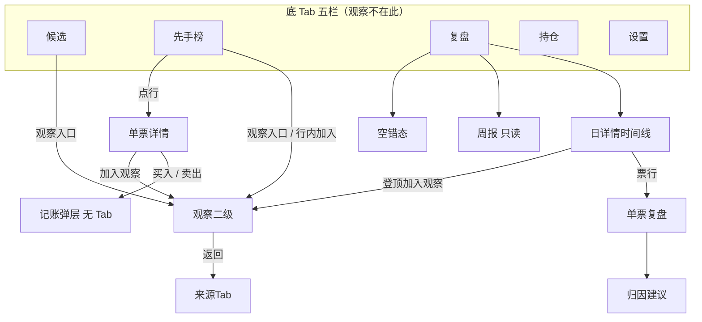

# 蓄势池 · C 契约 · 新版视觉稿（v0.1.0-C）

- 产品线：蓄势池（股票 App，与题刷刷无关）
- 日期：2026-11-11
- 角色：架构师 Arch
- 阶段：C（进仓契约 + UI 约束）。**本文件已放行**
- 版本：v0.1.0-C
- 仓：https://github.com/zh7551069/stock-agent-app
- 落点：同仓 `apps/mobile`（非独立仓）；BFF 仍为 `apps/bff`，端口 8770；`apps/bff/web` **不是**产品 UI
- 对照基线：`origin/main@027eed84`（2026-11-05；其前已合第一切片后端 `#1` `eafdc3ac`、归因 Flutter `#2` `028d332`、以及 `#3` 的 `design/dev-cache`——**样式不得再读该缓存**）
- 看板：`/Volumes/My PSSD/notion_files/蓄势池/board/蓄势池 · 切片交付看板__51699827.json`
- 契约归属：架构师；全栈不得私改路径 / 错误码 / 分页 / 硬约束不申报
- 合码：仅辉当面说「合」；写码或提 PR ≠ 合码

---

## 0. 开闸与门禁

开闸只认这一条：辉于 **2026-11-11 约 15:34 Asia/Shanghai** 在「蓄势池 · 新视觉评审」房间 @架构师Arch 亲口「确认进入完整交付」。

不以 2026-11-05 旧 App 壳正式 PRD、Owner / 他人转述、或房间点头直接交全栈为准。

写码仍等本契约与「UI 技术评审」三行齐后，由 **Owner 点全栈**。出齐前不拉全栈、不开 Cloud Agent、不写业务代码、不改 git。合码仅辉授权。

---

## 1. 样式源（权威）

只读 Figma Bridge 导出 HTML（及同目录 `styles.css` / `svgs/`）。禁止 `get_design_context`，禁止读 `design/dev-cache` 与 MCP `figma-dev-cache` 取样式。路径 A 预览目录 **不是**开发依据。仓内 `#3` 已提交的 `design/dev-cache` 不得作为本批对稿源。

| 包 | 本机权威路径 | 导出时间（Asia/Shanghai） | index sha256 | styles sha256 |
| --- | --- | --- | --- | --- |
| v1 主界面 | `/Users/zenghui/Documents/code/ai-tishuashua/design/bridge-export/stock/design/v1 主界面/` | 2026-11-11 14:47:27 | `603de742f6566cf0e3b53a20be6f3693003620c4a428f49c81744dd93c4cd529` | `122da314d0ae8d4843aa847f4ec445524c924f6417a36e39b27bbd0ee52fd1df` |
| 复盘 v1 | `/Users/zenghui/Documents/code/ai-tishuashua/design/bridge-export/stock/design/复盘 v1/` | 2026-11-11 12:49:17 | `fe714e08dbc3ed9c3203a7edc329a179f43fc2d9c5e85812b7249b2f767c429a` | `e9ac27f4290c96dfb1e6f648ea0316fddb69ed47fb439cc81763632a5eb048b8` |

PSSD 快照（哈希须与上表一致）：`/Volumes/My PSSD/notion_files/蓄势池/design/`。旧 12:48 主界面已备份为 `v1 主界面.bak-20261111-124850`，不再当样式源。

进仓 / Cloud 若开（须 Owner 点名且辉未禁止）：须附上述 `output/` 或拷进仓 `design/bridge-export/stock/`，不得改写读 Dev Mode 缓存。

---

## 2. 范围

### 2.1 做（本契约覆盖）

对稿范围 = 本批已导出业务帧（v1 主界面 14 帧 + 复盘 v1 9 帧），按 Android 先发切分实施：

| 阶段 | 内容 | 是否计入 Android MVP |
| --- | --- | --- |
| A0 | token、`AppShell`、`LpTabBar`（稿面线框 svg）、`LpNavHeader`；五栏与顶栏对现有业务页，**不单开启动页** | 是 |
| A1 | 归因四态 + 单票复盘嵌入；复用已合入的归因状态机 | 是 |
| A2 | 持仓四态 + `LpTradeSheet` 买/卖记账（单位股） | 是 |
| A3 | 候选池 + 先手榜（筛选、横幅、as-of 强制提示、行组件、观察入口） | 是 |
| A4 | 单票详情 + 观察四态（来源 Tab 选中） | 紧随，同一工程 |
| A5 | 复盘汇总、日详情时间线、周报、三类空错态（归因已在 A1） | 紧随，同一工程 |
| A6 | 设置完善（数据日期、竞价/盘中、免责、提醒开关、保留 BFF 地址） | 紧随，同一工程 |
| A7 | iOS 后置（同一 Flutter 工程） | **本批不验收** |

保持 Flutter，不换栈、不换仓。先交可安装的 Android 调试 / 内测包。

### 2.2 明确不做（本批）

- 条件单文案模板（等补稿；路径 A 文案模板预览可做，不当开发依据、不进本契约验收）
- 独立壳帧：启动页、权限页、登录、首次挂载引导（本批 Bridge 没有；缺则先用系统默认 Flutter 启动图）
- 浅色主题（稿面为占位）
- 分享面板 / 分享落地页
- 真分时 / 真日 K 行情图（详情允许「分时示意（占位）」，不得假装真行情）
- 系统推送（设置里「提醒」只做本地偏好，不承诺 OS 推送）
- 代下单、接券商、改先手分公式、手机直连 DuckDB
- 把观察做成第六底栏，或观察页五栏全未选中

### 2.3 覆盖旧口径（以本文件为准）

旧 App 壳正式 PRD（2026-11-05，XS-5）中与本批已锁定口径冲突的条目，按下面执行，不再回退：

| 项 | 旧壳 PRD | 本契约（已锁定） |
| --- | --- | --- |
| 底栏第一栏文案 | 「蓄势池」 | 「**候选**」；页标题写「**蓄势池**」，副标「**首板前蓄势 · 非已连板**」 |
| 冷启动默认 Tab | 「蓄势池」 | 「**候选**」（即第一栏，仅文案更新） |
| 观察进二级后的底栏 | 五栏组成不变（未写选中规则） | 五栏组成不变，且 **保持进入时的来源 Tab 选中**（先手榜或复盘） |
| 样式开工依据 | Figma Dev Mode node-id | **仅** §1 Bridge HTML；不再要求 `cache_rev` / `get_design_context` |

2026-11-04 C 契约（v0.2.0-C）的 **接口路径、错误码、硬约束 H1–H10** 仍然有效，本文件不重开一套 API。本批视觉实施 **0 个新业务 endpoint**。字段对不上稿面时：显示「字段缺失」或「待验证」，禁止用 0%、假列表或静默空池充数；缺口须申报后再改契约，不得私改。

---

## 3. 硬约束（不可改）

沿用并重申 2026-11-04 契约 H1–H10，并补本批已锁定项：

| # | 约束 |
| --- | --- |
| H1–H10 | 见 2026-11-04 C 契约：不改先手分公式；不代下单；手机只走 BFF；归因须确认才写入、不自动改先手分；5min 扫描与点触动量勿混；天量警示换手 >20%；顶格弱判定基准 = B（T+1 开）；pending 收益禁填 0%；分时 v1 文案标明 ≠先手分；缺数状态机显性；持仓数量单位 = **股** |
| H11 | 用户可见口径：先手分、流通市值筛选、数据日期、待验证。内部字段名（如 `score_adj`、`asof`）不得直接画到界面 |
| H12 | 流通市值筛选 **默认未强制**（稿面「全部 / 未强制」）；不得默认当成 50–150 亿硬过滤 |
| H13 | 候选池 **非买入信号**；相关免责须可见 |
| H14 | `no_data` / `no_disk` / 未挂载 **不得静默空池**。候选、先手榜本批 **没有**独立空/未挂载帧，生产仍须用与复盘同类的强制提示（`LpErrorCallout` / `LpAsOfLine` 升级），不得画空白列表充数 |
| H15 | 待验证禁止显示成 0%。复盘 v1 周报稿面 10/31 「A 中位」仍写了 `0.0%`：生产按「待验证」渲染，**不按该格对稿画出 0.0%**，也不改这份导出 |
| H16 | 观察是栈页、不进底 Tab；底栏保持来源 Tab 选中。14:47 主界面已核：`left=4300/4730 top=0` 来源先手榜（先手榜●）；`left=4300/4730 top=980` 来源复盘（复盘●） |
| H17 | 买入 / 卖出只用同一套 `LpTradeSheet`（`side: buy\|sell`）；页脚固定「记账写入本地持仓，不向券商发送委托」 |
| H18 | 归因四态复用已有实现（改标不 POST confirm；确认才写入；离开放弃不写库）；禁止再写一套状态机 |

---

## 4. 接口契约（沿用，不新开路径）

Base：`http(s)://{host}:8770`，路径均相对 `/api/liupan`。Android 模拟器访问本机 BFF 用 `http://10.0.2.2:8770`。

完整路径 / 入参 / 错误码 / 分页 / 幂等以 **2026-11-04 C 契约 §2** 为准。本批只列出实施时必须对上的使用关系：

| 页面 / 能力 | 调用 | 对稿要点 |
| --- | --- | --- |
| 候选池 | `GET /pool`（`tier?`，`mcap` 仅用户显式选择时带） | 锐利/实用/近板；蓄势分；无结果或未挂载强制提示 |
| 先手榜 | `GET /rank`（`mode=auction\|intraday`） | 用户文案「先手分」；可买 / 已涨停 / 水位；不得默认强制市值筛 |
| 单票详情 | `GET /detail` | 缺字段显示「字段缺失」；分时块允许占位，禁止假行情 |
| 设置 / as-of | `GET /status` | 文案「数据日期」；已挂载 / 未挂载 / 未过期 |
| 持仓列表 | `GET /positions` | 空仓走显性空态（稿：「暂无记账仓位…」） |
| 记账买 / 卖 | `POST /positions/buy\|sell` | `qty` 单位股；仅记账 |
| 点触动量 | `GET /momentum/intraday_path`、`GET /momentum/daily_k` | 用户点触才查，不自动刷新、不静默轮询；空仓仍允许点触 |
| 观察 | `GET/POST/PATCH|DELETE /watchlist` | 来源标签「自动第1」/「手动关注」对应 `auto_top1` / 手动；移除后同日再登顶可再入 |
| 复盘日 / 时间线 | `GET /review/day`、`GET /trace` | 缺失档显性空态、不伪造；登顶可入观察 |
| 周报 | `GET /review/week` | 只读建议议题；待验证不显示 0% |
| 归因 | `GET …/suggest`、`POST …/confirm`（路径拼写锁定于 2026-11-04 契约，不得平行再造） | 预勾 + 改标本地 + 确认写入 |

2026-11-04 契约 §2.8 的 TODO（幂等键、分页默认、顶格占比字段名等）本批 **不擅自钉死**；实施若必须选择，先申报架构再补丁。

---

## 5. 导航与壳

规则：

1. 底栏文案与顺序固定：**候选、先手榜、复盘、持仓、设置**。高 72（含底 inset 约 20）；背景 `rgb(21,27,36)`，内描边 `rgb(36,48,65)`；选中 `#F59E0B` 11px，未选 `rgb(139,155,180)`。
2. 冷启动默认 **候选**。根级切换不叠多层 Tab 历史。
3. 二级页（详情、观察、日详情、周报、单票复盘、归因、复盘空错态）仍露出五栏：详情保持来源栏（现稿从榜进入 → 先手榜●）；复盘子页保持复盘●；观察按 H16。
4. 买卖弹层、改标 Sheet、离开拦截是叠层，不带底栏。未确认归因时 Tab 切换继续走已有离开拦截。
5. 系统状态栏「5G / LTE / 电量」不是产品控件。画布 IA 注释与 `left=4890` 游离「移除」不是业务帧。
6. 设置帧稿面高度 860（其余 844），实现按 844 安全区 **可滚动**，不改安全区模型。

---

## 6. UI 约束（组件与 token）

同一类 UI 必须用同一个组件，禁止各页复制一套行 / 按钮 / 底栏。推荐落点 `apps/mobile/lib/widgets/`（`Lp` 前缀），详见 B 评估；本契约只锁必须统一的行为与视觉。

### 6.1 Token

沿用现有 `LiupanColors` 并收敛，不另起色板：

- 页面底 `#0B0F14`；卡片 / 底 Tab / 弹层 `#151B24`；描边 `#243041`
- 主文 `#E8EEF7`；次文 / Tab 未选 `#8B9BB4`；更弱提示 `#5C6B82`
- 选中与主按钮 `#F59E0B` / 墨色 `#1A1203`
- 表面、按钮、卡片半径 **0**（现控件若为 2，本批收敛到 0）。例外：开关轨道 `999`；时间线 / 状态圆点 `50%`
- 生产字体继续 **LiupanSans**，不按稿面 Inter 拉 Google Fonts
- 遮罩约 `rgba(0,0,0,0.67)`；主按钮高度约 48

### 6.2 必须统一的组件行为

| 组件 | 锁定规则 |
| --- | --- |
| `LpTabBar` | 只用一套；图标用本批 Bridge svg 线框，不用五套不同 Material 图标 |
| `LpNavHeader` | 根页大标题 + 副标；二级页返回 + 标题 + 右侧文本按钮 |
| `LpStockIdentity` + `LpStockRow` | 名称 + 6 位代码展示；请求仍用后缀式 code |
| `LpChip` | 近板、水位、可买/已涨停、自动第1/手动关注、未确认等走同一变体表 |
| `LiupanButton` | 主琥珀、次深底、成功禁用（「已确认写入 ✓」）；表面直角 |
| `LpTradeSheet` | 买/卖同一套；「100股起」视为数量步进提示，默认可按 100 的倍数加减，**不把 100 写成硬性最小记账数量**（若要改成硬校验，须 Owner 变更条）；单位不得改成「手」 |
| `LpEmptyState` / `LpErrorCallout` / `LpAsOfLine` | 持仓空、观察空用空态；复盘三类错误 + 池/榜缺数用强制提示 |
| 归因 | `AttrSection` + `RetagSheet` + `LeaveDialog` + `SuccessBanner`，视觉对齐新 token，不改状态机语义 |
| `LpChartPlaceholder` | 文案「分时示意（占位）」 |
| `LpMomentumPanel` | 待查询 / 查询中 / 结果；点触才查 |
| `LpMarketCapFilter` | 默认未强制 |
| `LpToggle` | 设置提醒三项；本批只存本地偏好。稿面「推送 / 通知」不解释成已有系统推送 |
| 设置「检查更新」 | 触发数据盘 / as-of 状态刷新，不默认做成应用商店更新 |
| 「分享」 | 本批不做落地；可保留按钮，点击提示「本版暂不提供」，不新开未出的页 |
| 「查看说明」 | 无落地帧；点击停留本页，展示已有三类说明卡全文，不新开页 |

---

## 7. 帧对照（对稿清单）

**v1 主界面（14 业务帧，另有 2 条 IA 注释与 1 处导出残留勿实现）：**

1. 候选池（页标题「蓄势池」，底栏候选●）
2. 蓄势先手榜
3. 单票详情（返回榜单，底栏先手榜●，分时占位）
4. 设置 / 数据（高 860，可滚动；浅色占位不做）
5. 记账买入弹层（无底栏）
6. 记账卖出弹层（无底栏）
7–10. 持仓：有仓 / 空态 / 查询中 / 分时动量结果（空仓仍可点触查询）
11–14. 观察有列表·来源先手榜；观察空态·来源先手榜；观察有列表·来源复盘（`top=980`）；观察空态·来源复盘

**复盘 v1（9 帧，底栏均为复盘●）：**

1. 复盘汇总（今日汇总 + 周报入口）
2. 日详情时间线（缺失档显性空态）
3. 单票复盘（分数拆解 + 归因预勾，「未确认」角标；待验证禁止 0%）
4. 周报（近 5 交易日，只读；10/31 稿面 0.0% 按 H15 处理）
5. 空态 / 错误态（同一帧三类：无轨迹 / 行情层不可用 / 外置盘未挂载）
6–9. 归因建议：须确认写入 / 改标中 / 已确认 / 离开拦截

---

## 8. 验收标准（可测）

1. 底栏文案与顺序为：候选、先手榜、复盘、持仓、设置；无「观察」栏；冷启动落在候选。
2. 页标题「蓄势池」、副标「首板前蓄势 · 非已连板」出现在对应根页；用户可见文案用先手分 / 数据日期 / 待验证，不用内部字段名。
3. 从先手榜进入的详情与观察，底栏保持先手榜●；从复盘进入的观察与复盘子页，底栏保持复盘●。
4. `no_data` / `no_disk` 时候选、先手榜、复盘均出现强制提示，不出现空白列表充数。
5. 待验证收益不显示 0%；即使周报稿面 10/31 为 0.0%，生产仍显示待验证。
6. 买卖弹层单位为股，页脚含「不向券商发送委托」；买/卖同一套组件。
7. 动量仅在用户点触后查询；归因改标不写库，确认写入才 POST confirm；离开放弃不写库。
8. 流通市值筛选默认未强制。
9. 分时块为占位示意，不假装真行情；浅色主题与分享落地本批不验收为已实现。
10. 表面半径为 0（开关与圆点例外）；生产字体为 LiupanSans。
11. 先发 Android 可安装包覆盖 A0–A3；A4–A6 可同仓续做，不作为 Android MVP 拒收条件，但本契约仍约束其一旦开工必须对稿。
12. 0 个新业务 endpoint；落点 `apps/mobile`；PR 交 Arch 评审后辉合码。

---

## 9. 开放问题（不挡本批开工）

1. 「100股起」若产品要改成硬性最小记账数量，走变更条，不在实现里默改。
2. 候选 / 先手榜独立空态、未挂载帧尚未进本批官方导出；建议 Owner 安排补帧，但不把路径 A 当对稿，也不因此禁 A3 开工。
3. 提醒若要做真系统推送，须另开范围。
4. 2026-11-04 契约 §2.8 字段级 TODO，需要时再补丁。

---

## 10. 进仓约定与下游节奏

- 契约进仓路径（尚未写入仓库，由后续授权合入）：`docs/contracts/xushichi-new-visual-C-contracts-v0.1.0-C.md`
- UI 三行进仓路径：`docs/delivery/xushichi-new-visual-ui-tech-review-20261111.md`
- 工程以进仓文件为权威；本地 `蓄势池/arch/` 可并存
- Owner 收齐开工包并点全栈后，全栈才写业务代码
- 不拆本文件去让全栈私自改接口；设计改动若动信息架构 / 接口，须架构再评

---

## 11. 文档状态

- 开闸：辉 2026-11-11 约 15:34 Asia/Shanghai 房间原话「确认进入完整交付」
- 本文件：v0.1.0-C，已放行
- 对照：`origin/main@027eed84`
- 未做：未拉全栈、未开 Cloud、未改 git、未改看板
